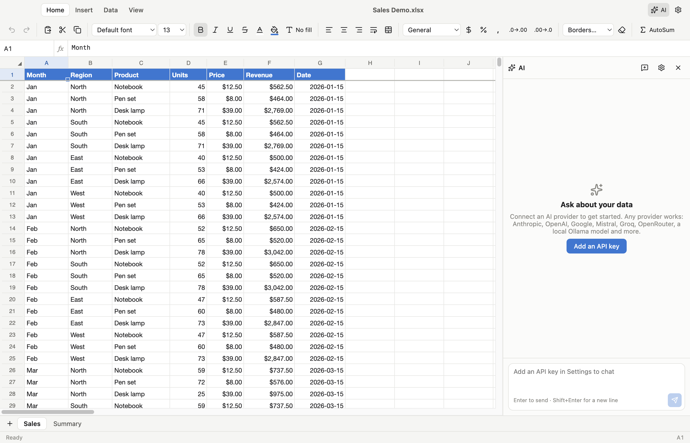

<p align="center"></p>

<h1 align="center">Open Sheets</h1>

<p align="center">A free, open-source spreadsheet app for macOS with Excel file support, live dashboards and a bring-your-own-key AI assistant.</p>

<p align="center"></p>

## Features

- **Spreadsheets** — canvas-rendered grid (1,048,576 × 16,384 cells), 400+ Excel-compatible functions, cross-sheet references, fill handle and series, sort, filter, remove duplicates, find & replace, freeze panes, merge cells, conditional formatting, number formats, borders, fonts and colors, unlimited undo/redo.
- **Files** — opens `.xlsx .xlsm .xltx .xltm .xls .xlt .xlsb .ods .fods .numbers .csv .tsv .txt .xml .html .dif .slk .dbf .prn`; saves `.xlsx` with full formatting plus `.xls .xlsb .ods .numbers .csv .tsv .html .xml .dif .slk .dbf`, and exports PDF / prints.
- **Dashboards** — dashboard tabs with drag-and-resize charts (column, stacked, bar, line, area, pie, doughnut, scatter, radar, funnel), KPI cards with comparisons, live tables and Markdown notes. Dashboards are stored inside the `.xlsx` (in a hidden sheet), so the file still opens normally in Excel.
- **AI assistant** — chat panel that can read, write, format, sort and chart your data, and build whole dashboards. Choose any model from any provider:
  Anthropic, OpenAI, Google Gemini, Mistral, Groq, xAI, DeepSeek, Cohere, OpenRouter, Together AI, Fireworks, Perplexity, Azure OpenAI, local **Ollama** / **LM Studio**, or any OpenAI-compatible endpoint you add.
- **Mac-native** — native menus and shortcuts, Finder file associations, recent documents, dark mode, unsaved-changes dot.

## Download

[**⬇ Download the latest release**](https://github.com/OWNER/open-sheets/releases/latest)

| Your Mac | Download |
| --- | --- |
| Apple silicon (M1 or later) | the `-arm64.dmg` file (or `-arm64-mac.zip`) |
| Intel | the `.dmg` file without `arm64` (or `-mac.zip`) |

Not sure which you have? Apple menu → **About This Mac**: "Chip: Apple M…" means Apple silicon, "Processor: Intel" means Intel.

**Install:** open the `.dmg` and drag **Open Sheets** into **Applications**. If you downloaded the `.zip`, unzip it and move the app to **Applications**.

All versions are listed on the [Releases page](https://github.com/OWNER/open-sheets/releases).

> Unsigned builds: macOS will say the app "can't be opened". Right-click the app → **Open**, or run `xattr -dr com.apple.quarantine "/Applications/Open Sheets.app"`.

## Using the AI assistant

1. Open **Settings** (⌘,) → **AI Providers**.
2. Paste an API key for any provider and click **Save**. Keys are encrypted with the macOS Keychain (Electron `safeStorage`) and stored only on your Mac; the renderer never sees them.
3. Click **Fetch models** to load the live model list, and tick the models you want in the picker (none ticked = all shown).
4. Press ⌘J to open the AI panel, choose a model at the top and ask away.

For local models, start Ollama or LM Studio, enable that provider (no key needed) and fetch models.

## Build from source

Requirements: macOS, Node.js 22+ and npm.

```bash
git clone https://github.com/OWNER/open-sheets.git
cd open-sheets
npm install
npm run dev              # run with hot reload
npm test                 # unit + file-format round-trip tests
npm run typecheck
npm run dist:mac         # build .dmg/.zip into release/<version>/
npm run dist:mac:unsigned  # same, skipping code signing
```

`node scripts/make-sample.mjs "samples/Sales Demo.xlsx"` regenerates the demo workbook.

> Running from a VS Code terminal? VS Code sets `ELECTRON_RUN_AS_NODE=1`, which makes Electron start as plain Node. The npm scripts unset it for you; if you launch Electron by hand, run `unset ELECTRON_RUN_AS_NODE` first.

## Publishing a release

1. Bump `version` in `package.json` and push a tag: `git tag v0.1.0 && git push --tags`.
2. The **Release** workflow tests, builds arm64 + x64 `.dmg`/`.zip` files and attaches them to a GitHub Release.
3. Optional signing and notarization: add these repository secrets — `MAC_CERT_P12_BASE64`, `MAC_CERT_PASSWORD` (Developer ID Application certificate), `APPLE_ID`, `APPLE_APP_SPECIFIC_PASSWORD`, `APPLE_TEAM_ID`. Without them the workflow publishes unsigned builds.
4. The **Website** workflow publishes `website/` to GitHub Pages (enable Pages → "GitHub Actions" in repo settings). Its download button points to the latest release.

Replace `OWNER` in `package.json`, `src/main/menu.ts`, `src/renderer/src/components/Settings.tsx`, `website/index.html` and this README with your GitHub user or organization.

## Architecture

```
src/
  main/          Electron main process — windows, menus, file I/O, Keychain-encrypted keys,
                 AI providers (Vercel AI SDK) and the tool-calling chat loop
  preload/       Minimal, typed bridge exposed as window.api (context-isolated, sandboxed)
  shared/        Types shared by both sides
  renderer/src/
    engine/      Workbook model: HyperFormula for values/formulas, plus styles, layout,
                 dashboards and a unified undo stack
    io/          Import/export — ExcelJS for styled .xlsx, SheetJS for every other format
    components/  Canvas grid, ribbon, formula bar, dashboards (ECharts + react-grid-layout),
                 AI panel, settings and dialogs
    ai/          Spreadsheet tools the AI can call (executed against the open workbook)
tests/           Vitest: engine behaviour and file-format round trips
```

The AI runs in the main process: the model's tool calls are sent to the renderer, which applies them to the workbook as normal undoable edits.

## Known limitations

- Charts, pivot tables, macros (VBA), images and comments inside imported Excel files are not shown yet, and are not written back on save. Saving an `.xlsm` produces an `.xlsx` without macros.
- Formatting is fully preserved only in `.xlsx`; other formats keep values, formulas, number formats, merges and column widths.
- Functions not supported by HyperFormula show `#NAME?`.

See [CONTRIBUTING.md](CONTRIBUTING.md) to help close these gaps.

## License

GPL-3.0-or-later. Open Sheets uses [HyperFormula](https://hyperformula.handsontable.com/) under its GPLv3 license, [ExcelJS](https://github.com/exceljs/exceljs) (MIT), [SheetJS CE](https://sheetjs.com/) (Apache-2.0), [Apache ECharts](https://echarts.apache.org/) (Apache-2.0) and the [Vercel AI SDK](https://ai-sdk.dev/) (Apache-2.0).

Open Sheets is an independent project and is not affiliated with Microsoft. Excel is a trademark of Microsoft Corporation.
